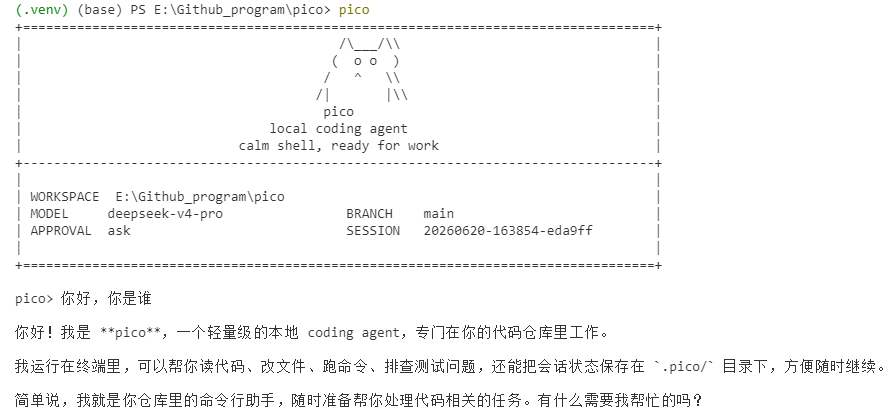

# pico

`pico` 是一个面向代码仓库的轻量本地 coding agent。它直接跑在终端里，先看当前工作区，再用一组受约束的工具去读文件、改文件、跑命令，并把会话状态保存在本地 `.pico/` 目录里。

它更像一个能在仓库里持续工作的命令行助手，不是纯聊天窗口。你可以拿它做代码排查、测试修复、仓库分析，或者让它在当前项目里执行一次性的工程任务。

## 适合做什么

- 在本地仓库里排查测试失败
- 读取当前代码结构并给出修改建议
- 基于现有文件做小步迭代，而不是脱离仓库空想
- 在会话中保留上下文，支持继续上一次工作

## 主要特性

- 包名是 `pico`
- CLI 命令是 `pico`
- 模块入口是 `python -m pico`
- 会话保存在 `.pico/sessions/`
- 每次运行的工件保存在 `.pico/runs/<run_id>/`
- 支持四类模型后端：
  - Ollama
  - OpenAI 兼容 Responses API
  - Anthropic 兼容 Messages API
  - DeepSeek Anthropic 兼容 API

## 使用截图

CLI 帮助信息：


启动界面：



REPL 内置命令与会话路径：


## 安装

需要 Python 3.10+。

如果你用 `uv`，直接安装依赖：

```bash
uv sync
```

如果你已经在自己的 Python 环境里工作，也可以直接装成可编辑模式：

```bash
pip install -e .
```

## 快速开始

在当前仓库里启动交互模式。默认 provider 是 DeepSeek：

```bash
uv run pico
```

指定另一个工作目录：

```bash
uv run pico --cwd /path/to/repo
```

直接跑一次性任务：

```bash
uv run pico "inspect the test failures and propose a fix"
```

如果当前环境已经安装过包，也可以直接这样启动：

```bash
python -m pico
```

## 模型后端

Pico 启动时会读取项目根目录的 `.env`。本地真实 key 放在 `.env`，仓库只保留 `.env.example`。配置优先级是：

```text
显式 CLI 参数 > .env 里的 PICO_* 变量 > 旧环境变量 > 代码默认值
```

不传 `--provider` 时默认使用 `deepseek`。这是推荐配置路径：DeepSeek 的 Anthropic-compatible endpoint 比本地 Ollama 更少依赖本机模型环境，也比 OpenAI-compatible/Anthropic-compatible 代理少一层默认 gateway 假设。其他 provider 仍然保留，可以显式传 `--provider openai`、`--provider anthropic` 或 `--provider ollama`。

`.env` 会在构建 provider client 前加载，并覆盖当前进程里的同名环境变量。模型名和 base URL 可以通过 `--model`、`--base-url` 临时覆盖；API key 只从环境变量读取。

本地第一次配置：

```bash
cp .env.example .env
```

然后把要使用的 provider key 填进去。`.env` 已经被 `.gitignore` 忽略，不要提交真实 key。

### 推荐配置：DeepSeek

最小配置只需要 key：

```bash
PICO_DEEPSEEK_API_KEY="your-api-key"
```

默认模型和接口是：

```bash
PICO_DEEPSEEK_API_BASE="https://api.deepseek.com/anthropic"
PICO_DEEPSEEK_MODEL="deepseek-v4-pro"
```

所以常规情况下 `.env` 里只填 `PICO_DEEPSEEK_API_KEY` 就能直接启动：

```bash
uv run pico
```

如果你需要临时切模型或代理地址，不必改 `.env`，可以直接覆盖：

```bash
uv run pico --model deepseek-v4-pro --base-url https://api.deepseek.com/anthropic
```

DeepSeek 当前走 Anthropic-compatible Messages API，所以 runtime 里复用的是 Anthropic-compatible client；这只影响 HTTP 协议，不影响 CLI 用法。

### 可选配置：right.codes

right.codes 在 Pico 里有两条可选 provider 路径：

- `--provider openai`：走 OpenAI-compatible `/responses`，默认 base URL 是 `https://www.right.codes/codex/v1`，默认模型是 `gpt-5.4`
- `--provider anthropic`：走 Anthropic-compatible `/messages`，默认 base URL 是 `https://www.right.codes/claude/v1`，默认模型是 `claude-sonnet-4-6`

如果 right.codes 给你的是一把共享 key，推荐只填这一项：

```bash
PICO_RIGHT_CODES_API_KEY="your-right-codes-key"
```

然后按需要选择 provider：

```bash
uv run pico --provider openai
uv run pico --provider anthropic
```

如果你想显式区分两条 provider 的 key，也可以分别配置：

```bash
PICO_OPENAI_API_KEY="your-right-codes-key-for-codex"
PICO_ANTHROPIC_API_KEY="your-right-codes-key-for-claude"
```

不要在 `.env` 里写 `PICO_OPENAI_API_KEY=$PICO_RIGHT_CODES_API_KEY` 这种 shell 展开形式；Pico 的 `.env` 解析器只读取字面量，不展开变量引用。要么只写 `PICO_RIGHT_CODES_API_KEY`，要么把 key 字符串分别填到 provider-specific 变量里。

如果请求 right.codes 返回 `API Key额度不足`，说明协议和 endpoint 已经打通，但当前 key 没有可用额度；换一把有额度的 key，或到 right.codes 后台处理额度。

当前 provider 环境变量：

| provider | base URL | API key | model |
| --- | --- | --- | --- |
| `deepseek` | `PICO_DEEPSEEK_API_BASE`，回退 `DEEPSEEK_API_BASE`，默认 `https://api.deepseek.com/anthropic` | `PICO_DEEPSEEK_API_KEY`，回退 `DEEPSEEK_API_KEY` | `PICO_DEEPSEEK_MODEL`，回退 `DEEPSEEK_MODEL`，默认 `deepseek-v4-pro` |
| `openai` | `PICO_OPENAI_API_BASE`，回退 `OPENAI_API_BASE`，默认 `https://www.right.codes/codex/v1` | `PICO_OPENAI_API_KEY`，回退 `OPENAI_API_KEY`、`PICO_RIGHT_CODES_API_KEY`、`RIGHT_CODES_API_KEY`、`PICO_ANTHROPIC_API_KEY`、`ANTHROPIC_API_KEY` | `PICO_OPENAI_MODEL`，回退 `OPENAI_MODEL`，默认 `gpt-5.4` |
| `anthropic` | `PICO_ANTHROPIC_API_BASE`，回退 `ANTHROPIC_API_BASE`，默认 `https://www.right.codes/claude/v1` | `PICO_ANTHROPIC_API_KEY`，回退 `ANTHROPIC_API_KEY`、`PICO_RIGHT_CODES_API_KEY`、`RIGHT_CODES_API_KEY`、`PICO_OPENAI_API_KEY`、`OPENAI_API_KEY` | `PICO_ANTHROPIC_MODEL`，回退 `ANTHROPIC_MODEL`，默认 `claude-sonnet-4-6` |
| `ollama` | `--host`，默认 `http://127.0.0.1:11434` | 不需要 | `--model`，默认 `qwen3.5:4b` |

如果有额外的敏感环境变量需要从 trace/report 里脱敏，可以用 `PICO_SECRET_ENV_NAMES` 配置逗号分隔的变量名，或启动时重复传 `--secret-env-name NAME`。

### OpenAI 兼容接口

如果要改用 OpenAI-compatible `/responses` 服务，显式传 `--provider openai`：

```bash
uv run pico --provider openai
```

默认 OpenAI 兼容接口使用 right.codes 的 Codex endpoint：

```bash
PICO_OPENAI_API_BASE="https://www.right.codes/codex/v1"
PICO_RIGHT_CODES_API_KEY="your-right-codes-key"
PICO_OPENAI_MODEL="gpt-5.4"
```

也可以改成其他 OpenAI-compatible 服务：

```bash
PICO_OPENAI_API_BASE="https://your-api.example/v1"
PICO_OPENAI_API_KEY="your-api-key"
PICO_OPENAI_MODEL="gpt-5.4"
```

### Anthropic 兼容接口

如果要改用 Anthropic-compatible 服务，显式传 `--provider anthropic`：

```bash
uv run pico --provider anthropic
```

默认 Anthropic 兼容接口使用 right.codes 的 Claude endpoint：

```bash
PICO_ANTHROPIC_API_BASE="https://www.right.codes/claude/v1"
PICO_RIGHT_CODES_API_KEY="your-right-codes-key"
PICO_ANTHROPIC_MODEL="claude-sonnet-4-6"
```

如果你的服务端对多个兼容接口复用了同一套密钥，`pico` 也支持从 `PICO_ANTHROPIC_API_KEY` 回退到 `ANTHROPIC_API_KEY`、`PICO_RIGHT_CODES_API_KEY`、`RIGHT_CODES_API_KEY`、`PICO_OPENAI_API_KEY` 或 `OPENAI_API_KEY`。

### Ollama

如果要改用本地 Ollama，显式传 `--provider ollama`：

```bash
ollama serve
ollama pull qwen3.5:4b
uv run pico --provider ollama --model qwen3.5:4b
```

## 常用交互命令

- `/help`：查看内置命令
- `/memory`：查看提炼后的工作记忆
- `/session`：查看当前会话文件路径
- `/tasks`：查看最近一次多 agent 协作的任务看板
- `/reset`：清空当前会话状态
- `/exit` 或 `/quit`：退出 REPL

## 安全与持久化

`pico` 不会默认把所有动作都放开。像 shell 执行、文件写入这类高风险操作，会受审批模式控制：

- `--approval ask`
- `--approval auto`
- `--approval never`

每次运行结束后，都会在 `.pico/runs/<run_id>/` 下写出这些文件：

- `task_state.json`
- `trace.jsonl`
- `report.json`

这些内容默认只保存在本地，不需要跟仓库一起提交。

## 项目架构

pico 的核心思路：**模型只负责"决策"，其余都交给 harness（包在模型外面的控制程序）。** 模型每轮只能提出一个动作申请（调用某个工具或给出最终答案），这些申请必须经过校验、审批、执行、记录的完整链路才会真正落到仓库上，每一步都写进可复盘的运行工件。

### 一次 `ask()` 的控制循环

单个 agent 的主循环（`pico/agent_loop.py`）是同步阻塞的，可以按"感知 → 决策 → 行动 → 记录"理解：

1. **组装 prompt**：把稳定前缀（规则 + 工具表 + 工作区快照）、工作记忆、相关笔记、压缩后的历史、当前请求，按预算拼成一条完整 prompt。
2. **调用模型**：同步请求模型后端，拿到原始输出。
3. **解析**：把输出分成四类——单个工具调用 `<tool>`、批量只读调用 `<tools>`、格式错误需重试 `retry`、最终答案 `<final>`。
4. **执行工具**：经过白名单 → 参数校验 → 重复调用拦截 → 高风险审批 → 执行前后工作区快照 diff 的完整护栏。
5. **记录**：结果写入历史、精炼进工作记忆，并落 trace 事件、建 checkpoint。
6. 回到第 1 步，直到给出最终答案，或触发停机条件（步数上限 / 重试上限 / 取消）。

### 模块地图

```
pico/
├── cli.py              启动与装配：参数 → .env → provider client → 工作区 → runtime
├── runtime.py          Pico 运行时外观：组合各子系统、解析输出、安全策略、工具注册
├── agent_loop.py       主循环：组 prompt → 调模型 → 解析 → 执行 → 记录
├── context_manager.py  分段预算与逐步裁剪，产出 prompt 和 metadata
├── context_budget.py   按模型窗口推算预算（字符预算 + token 上限两层）
├── prompt_prefix.py    稳定前缀：规则 + 工具表 + 工作区快照，算 hash 当缓存键
├── workspace.py        git 分支/状态/提交 + 项目文档 → 工作区快照与指纹
├── tools.py            工具白名单、参数校验、执行函数
├── tool_executor.py    工具执行链路；只读工具并行批处理，写操作串行
├── tool_context.py     工具执行上下文（路径解析、shell 环境、委派句柄）
├── checkpoint.py       checkpoint 链、文件新鲜度、运行环境比对、恢复状态
├── security.py         环境变量白名单、密钥检测与脱敏
├── session_store.py    .pico/sessions/*.json（可恢复的会话状态，原子写）
├── run_store.py        .pico/runs/<id>/（审计工件：task_state / trace / report）
├── task_state.py       单次运行的状态机（状态、停机原因、工具步数）
├── features/memory.py  分层记忆：工作记忆 / 文件摘要 / 情节笔记 / 持久记忆
├── providers/clients.py  统一的 complete() 接口：Ollama / OpenAI / Anthropic
├── agents/             角色注册表 + 四类内置角色（多 agent）
├── orchestration/      多 agent 编排：看板、交接、调度、预算、隔离、合并、黑板
└── evaluation/         benchmark 评测器 + 消融/压测/多 agent 评测
```

### 分层上下文治理

`context_manager` 决定每轮把多少内容送进模型。prompt 分五段，各有预算：prefix、memory、relevant_memory、history、current_request（当前请求永不裁剪）。超预算时按固定优先级收缩：先丢相关笔记，再压历史，然后才动记忆和规则。预算由 `context_budget` 按模型窗口推算，分字符和 token 两层上限；旧的固定 12400 字符预算作为 compact 模式保留。历史压缩分两档：最近若干条尽量保留，更早的 read_file 去重、有摘要就用摘要代替原文。每轮都记录各段的原始/渲染长度和裁剪日志，供复盘。

### 分层记忆

`features/memory` 把记忆分四层：**working**（当前任务摘要 + 最近接触的文件，滑动窗口）、**file_summaries**（读文件后的短摘要，带 sha256 新鲜度，文件改了就失效）、**episodic_notes**（最多 12 条跨轮笔记，按 tag/关键词/新鲜度召回 top-3，不用 embedding）、**durable**（`.pico/memory/`，有准入与拒收规则——像密钥、临时状态、超长输出会被拒收，同一主语的旧条目被新条目替换）。

### Checkpoint 与恢复

checkpoint 是一条带父指针的链，记录当前目标、卡点、下一步、关键文件及其新鲜度、运行环境。恢复时比对两样东西：文件 sha256 和运行环境字段（模型、工具签名、工作区指纹、审批策略等），判定出 no-checkpoint / full-valid / partial-stale / workspace-mismatch / schema-mismatch 五种状态，并把 checkpoint 文本注入 prefix 最前面。本质是"带校验的上下文重新锚定"，不是执行状态回放。

### 工具护栏与安全

每次工具调用都经过：白名单 → 工具是否存在 → 参数校验（报错附正确示例）→ 连续重复调用拦截 → 高风险工具审批（ask/auto/never，只读模式一律拒绝）→ 执行前工作区快照 → 执行 → 执行后快照 diff → 回写记忆与过程笔记。路径先 resolve 再锚定在仓库根下，防 `../` 和软链接逃逸；shell 只拿到环境变量白名单；密钥在 trace/report 落盘前脱敏。

### 可观测性

三类运行工件分工：`task_state.json`（原子写，记"跑到哪了"）、`trace.jsonl`（只追加，记"做了什么"）、`report.json`（记结果与关键指标）。会话状态（可恢复）和运行工件（可复盘）分开存，互不混淆。

### 模型后端抽象

`providers/clients` 把 HTTP、SSE、usage 字段差异都封装起来，对上层暴露统一的 `complete()`。支持三类协议（OpenAI Responses / Anthropic Messages / Ollama）、四个 provider（DeepSeek 复用 Anthropic 协议）。runtime 不感知后端差异。

## 多 Agent 协作

顶层 agent 可以把一个大任务拆给多个受限子 agent 并行完成。四类内置角色：explorer（只读调查）、worker（可写，限定文件范围）、reviewer（跑测试验收）、planner（只读规划）。角色定义在 `pico/agents/builtin/*.md`，可在仓库的 `.pico/agents/` 下新增或覆盖同名角色。

编排通过几个内置工具完成（仅顶层 agent 可用，子 agent 拿不到，因此委派深度固定不超过 1）：

- `plan_tasks`：把任务写入任务看板。每个任务含 `role`、`goal`、`acceptance`、`verify`、`depends_on`、`write_scope` 等字段。
- `run_tasks`：执行就绪任务（依赖已满足的），默认最多 3 个并行，等这一批全部结束后返回每个任务的结果摘要。
- `board`：查看当前任务看板。
- `integrate` / `apply_integration`：把各 worker 分支合并、验证通过后应用回主工作区（git 仓库）。
- `select_variant`：best-of-N 场景下手动择优。

关键设计：

- **隔离写入（git 仓库）**：每个 worker 在独立的 `git worktree` 和分支上改代码，互不干扰，也不碰主工作区；最后由 Integrator 合并、检查冲突与越界，`apply_integration` 应用回主工作区时需要审批。非 git 仓库自动退回“串行、直接写主工作区”。
- **越界防护**：worker 只能改 `write_scope` 声明的文件；实际改动以 `git diff` 为准核验，越界的任务标记为 `scope_violation`，默认不合并。
- **全局预算**：整次协作的总步数、估算 token、任务数都有上限，耗尽即停。用 `--max-concurrency`、`--max-total-steps`、`--max-tasks` 调整。
- **结构化交接**：父 agent 给子 agent 下发 Brief（目标、验收、写范围、相关文件摘要），子 agent 回传结构化 Result；父 agent 的历史里每个任务只记一条摘要，完整过程留在子 run 目录。
- **可复盘**：每次协作的任务看板存为 `.pico/runs/<run_id>/board.json`；`report.json` 带 `multi_agent` 汇总（任务数、并发峰值、加速比、冲突与越界次数）。用 `pico --runs-tree <run_id>` 查看父子运行树。

设计细节见 `docs/architecture/multi-agent-v1-design.md`。

## 开发

常用本地检查：

```bash
uv run pytest tests -q
uv run ruff check pico tests scripts
```

内部代码现在按较轻的边界拆分：`pico/evaluation/` 放 benchmark 和 metrics，`pico/providers/` 放模型 provider client，`pico/features/` 放可选运行时能力。新代码应直接使用这些包路径；旧的 `pico.evaluator`、`pico.metrics`、`pico.models` 和 `pico.memory` import 不再作为公共入口保留。

## 更新日志
# 7.14b
- **多 agent 协作增强（v2）**：子 agent 之间通过只追加的共享黑板（`post_note`/`read_notes`）和非阻塞信箱（`send_message`/`check_inbox`）交换信息，不直接对话以避免同步模型下的死锁；卡住时返回 `blocked`+`needs` 向上求助。组长侧 `run_tasks` 改为按波（wave）调度、每波返回结构化进度摘要，并可用 `amend_tasks`/`cancel_tasks`/`answer_need` 在波次之间调整计划、中止（但不改写）正在跑的任务。详见 `docs/architecture/multi-agent-v2-collaboration.md`。
# 7.14
- **多 agent 协作**：新增 `pico/orchestration/`（任务看板、上下文交接、并行调度、预算账本、审批串行化、取消、git worktree 隔离、分支合并、best-of-N）与 `pico/agents/`（角色注册表 + 四类内置角色）。顶层 agent 新增 `plan_tasks` / `run_tasks` / `board` / `integrate` / `apply_integration` / `select_variant` 工具；子 agent 不可编排，委派深度固定不超过 1。
- **上下文预算**：预算改为按模型窗口推算（字符预算 + token 上限两层），最近历史窗口、单条上限、工具输出上限随预算放大；旧的固定预算作为 compact 模式保留，默认行为不变。
- **Windows 兼容**：时区回退、验收命令不经 shell 执行、shell 环境保留系统必需变量、输出解码容错。
- **前置修复**：批处理结果不再重复写入历史；记忆更新加锁；子 agent 独立 model_client 实例、禁写持久记忆、子 session 隔离并记录父子关联。
# 6.23
- **工具批处理执行**：`ToolExecutor` 新增 `execute_batch()`。模型用 `<tools>{"calls": [...]}</tools>` 一次声明多个工具调用，runtime 分两个阶段执行：阶段 1 将所有 `read_file` / `search` / `list_files` 通过 `ThreadPoolExecutor`（max_workers=4）并行执行，阶段 2 将 `write_file` / `patch_file` / `run_shell` / `delegate` 在读取全部完成后按原始顺序逐个串行执行。      读串行 550ms，并行2955ms。
- **Prompt 适配**：system prompt 新增并行读取的规则说明与格式示例；prefix budget 从 3600 → 4000、总 budget 从 12000 → 12400，避免 checkpoint 等附加文本被截断。
- **⚠ 已知潜在隐患**：
  - `shell=True` 命令注入：`run_shell` 仍以 `shell=True` 执行模型生成的字符串，$()、`` ` `` 等 shell 元字符可被利用。当前仅靠环境变量白名单和审批策略缓解，未做真正的进程隔离。
  - TOCTOU 双重路径解析：`validate_tool()` 和实际工具函数各自 resolve 路径，校验与使用之间存在窗口，可能被 symlink 替换绕过。修复方向：一次 resolve 后传 resolved path
  - 同步 IO 阻塞：整个 client 和 executor 仍使用 `urllib.request` + `subprocess.run` 同步模型，无法实现流式输出，工具执行期间 agent loop 完全卡住。
  - 写操作串行执行：虽然 reads 已并行化，batch 内的 writes 仍逐个串行，且不同 batch 之间的 writes 仍需多轮往返，存在进一步并行化空间（需引入依赖 DAG 和冲突检测）
  
# 6.20
- **Session 原子写入**：`SessionStore.save()` 改为先写临时文件再原子替换（与 `RunStore._write_json_atomic` 一致），避免进程中途崩溃时留下半截 JSON 导致会话状态丢失。
<!-- commit 1: 2026-06-28_21:40:53 -->

<!-- commit 2: 2026-06-28_21:40:53 -->

<!-- commit 3: 2026-06-28_21:40:53 -->

<!-- commit 4: 2026-06-28_21:40:53 -->

<!-- commit 5: 2026-06-28_21:40:53 -->

<!-- update: 2026-06-30_16:51:31 -->
